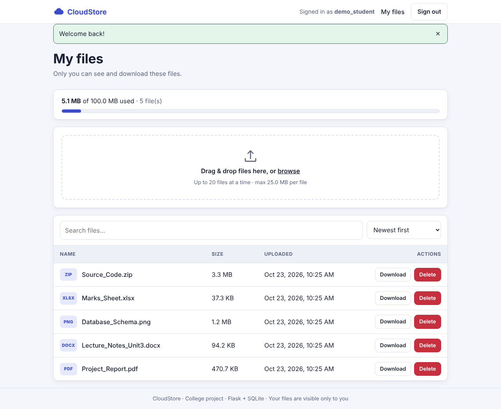

# CloudStore - Cloud-Based File Storage System

A complete, college-level web application where users register, sign in and manage **their own** files
in the cloud: upload, list (with file sizes), download and delete - with strict per-user access control.

* **Backend:** Python 3 + Flask
* **Frontend:** HTML5, CSS3, JavaScript (no frameworks, no CDN - works offline)
* **Storage:** SQLite (users + file metadata) and server-side per-user folders (file bytes)
* **No Firebase, no API keys, no external services** - nothing to configure before the first run.



---

## Features

| Requirement | Implementation |
|-------------|----------------|
| User registration | Username, email, password with validation, duplicate detection (client + server side) |
| Login / logout | Username *or* email; salted password hashes; session cookie; login lock-out after repeated failures |
| File upload | Browse or drag & drop, several files at once, live progress bar, per-file and per-user limits |
| File listing | Name, type badge, **size**, upload time; search and six sort orders |
| File size display | Per-file size (B / KB / MB / GB) and a **storage meter** (used / quota) |
| Download | One click, served as attachment with the original file name |
| Delete | Confirmation dialog; removes both database record and stored bytes |
| Access control | Every query is filtered by the signed-in user; other users' files return 404 |
| Error handling | Friendly HTML error pages, JSON errors for the API, toast notifications, validation messages |
| Responsive UI | Mobile-first layout, table turns into cards on phones, automatic dark mode |
| Security | CSRF tokens, CSP, secure headers, path-traversal-safe storage, blocked executables |

---

## Project structure

```
cloud-file-storage/
├── run.py                      # start the server
├── config.py                   # settings (env-driven)
├── requirements.txt            # runtime dependencies
├── requirements-dev.txt        # + Playwright (optional, for screenshots)
├── .env.example                # optional configuration template (no secrets)
├── .gitignore
├── README.md
├── app/
│   ├── __init__.py             # app factory + error handlers
│   ├── db.py                   # SQLite helpers + schema
│   ├── auth.py                 # register / login / logout
│   ├── files.py                # upload / list / download / delete
│   ├── utils.py                # login_required, CSRF, headers, helpers
│   ├── templates/              # base, index, register, login, dashboard, error
│   └── static/                 # css/style.css, js/app.js, img/favicon.svg
├── storage/                    # uploaded files (created per user at runtime)
├── instance/                   # SQLite database + auto-generated secret key
├── tests/test_app.py           # 39 automated tests
├── scripts/capture_screenshots.py
└── docs/
    ├── PROJECT_REPORT.md       # full project report  (+ PROJECT_REPORT.docx)
    ├── ARCHITECTURE.md         # architecture, ER, sequence diagrams
    ├── architecture.svg / .png # architecture diagram
    ├── SCREENSHOTS.md          # screenshot index + capture instructions
    └── screenshots/            # 11 PNG screenshots
```

---

## Quick start

Requirements: **Python 3.10 or newer** (tested on 3.13) and `pip`.

### Windows (PowerShell)
```powershell
cd cloud-file-storage
python -m venv venv
venv\Scripts\activate
pip install -r requirements.txt
python run.py
```

### macOS / Linux
```bash
cd cloud-file-storage
python3 -m venv venv
source venv/bin/activate
pip install -r requirements.txt
python run.py
```

Open **http://127.0.0.1:5000**, click *Create account*, sign in and upload a file.

The database, storage folders and a random secret key are created automatically on first start.

---

## Configuration (optional)

Copy `.env.example` to `.env` and change what you need. All values are optional.

| Variable | Default | Meaning |
|----------|---------|---------|
| `SECRET_KEY` | auto-generated in `instance/secret_key` | Signs session cookies. **Set your own in production.** |
| `HOST` / `PORT` | `127.0.0.1` / `5000` | Server address |
| `MAX_FILE_MB` | `25` | Maximum size of one file |
| `MAX_REQUEST_MB` | `100` | Maximum size of one upload request |
| `USER_QUOTA_MB` | `100` | Storage quota per user |
| `MAX_FILES_PER_UPLOAD` | `20` | Files per upload |
| `SESSION_HOURS` | `2` | Session lifetime |
| `LOGIN_MAX_ATTEMPTS` / `LOGIN_LOCK_SECONDS` | `5` / `300` | Brute-force protection |
| `COOKIE_SECURE` | `0` | Set `1` when using HTTPS |

> Never commit a real `SECRET_KEY`. The `.gitignore` already excludes `.env`, `instance/` and `storage/`.

---

## Using the application

1. **Register** - choose a username (3-30 letters/numbers/underscores), email and a password (8+ characters with a letter and a number).
2. **Sign in** with your username or email.
3. **Upload** - drag files onto the dashed box or click *browse*. A progress bar and notification confirm the result.
4. **Browse** - see each file's size and upload date; the meter shows how much of your quota is used. Search or sort the list.
5. **Download** - click *Download*. **Delete** - click *Delete* and confirm.
6. **Sign out** from the top-right menu.

---

## REST API

All endpoints require a signed-in session. State-changing requests need the `X-CSRF-Token` header
(the front-end reads it from the page automatically).

| Method | URL | Description | Success | Errors |
|--------|-----|-------------|---------|--------|
| GET | `/api/files` | List own files + usage | 200 | 401 |
| POST | `/api/files` | Upload (`multipart/form-data`, field `files`, repeatable) | 201 | 400, 401, 413 |
| GET | `/api/files/<id>/download` | Download own file | 200 | 401, 404 |
| DELETE | `/api/files/<id>` | Delete own file | 200 | 400, 401, 404 |

Errors are JSON: `{"error": "message"}`.

---

## Access control - how it works

* Each file row stores `user_id`; the bytes live in `storage/<user_id>/<random-uuid>`.
* Every list / download / delete query contains `WHERE ... AND user_id = <signed-in user>`.
* A request for another user's file id returns **404**, identical to a non-existent id (no information leak).
* The test-suite proves it: `test_user_cannot_list_others_files`, `..._download_...`, `..._delete_...`.

---

## Running the tests

```bash
python -m unittest discover -s tests -v
```

39 tests cover registration, validation, hashing, login, lock-out, CSRF, upload / download / delete,
quotas, size limits, blocked types, path traversal, access control, error pages and security headers.

## Screenshots

See [`docs/SCREENSHOTS.md`](docs/SCREENSHOTS.md). To regenerate them:

```bash
pip install -r requirements-dev.txt
playwright install chromium
python scripts/capture_screenshots.py
```

## Documentation

* [`docs/PROJECT_REPORT.md`](docs/PROJECT_REPORT.md) (also as `.docx`) - full academic report
* [`docs/ARCHITECTURE.md`](docs/ARCHITECTURE.md) - architecture, ER and sequence diagrams

---

## Deploying to the cloud (optional)

The app is a standard WSGI application (`run:app`). For a public deployment:

1. Copy the project to a cloud VM (AWS EC2, Azure VM, Google Compute Engine, DigitalOcean...) or a PaaS that
   provides a **persistent disk** (Render, Railway, PythonAnywhere). Persistent disk matters because files
   and the SQLite database are stored on disk.
2. `pip install -r requirements.txt gunicorn` (Linux) - on Windows hosts use `waitress`.
3. Set `SECRET_KEY` to a long random value and `COOKIE_SECURE=1`.
4. Run: `gunicorn -w 2 -b 0.0.0.0:8000 run:app` behind HTTPS (Nginx / Caddy / platform TLS).
5. Back up `instance/` and `storage/` regularly.

## Troubleshooting

| Problem | Fix |
|---------|-----|
| `ModuleNotFoundError: flask` | Activate the virtual environment and run `pip install -r requirements.txt` |
| Port 5000 already in use (macOS AirPlay) | `PORT=5001 python run.py` (PowerShell: `$env:PORT=5001; python run.py`) |
| "Invalid or missing security token" | The page was open too long or cookies are blocked - refresh the page |
| Upload fails with "larger than limit" | Raise `MAX_FILE_MB` / `MAX_REQUEST_MB` |
| Forgot to sign out on shared PC | Sessions expire automatically after `SESSION_HOURS` |

## Known limitations

* Login throttling is kept in memory (resets on restart; per-process when using several workers).
* SQLite and local disk suit small/medium deployments; for scale, move to PostgreSQL and object storage (S3).
* No password reset e-mail, file sharing or folders (listed as future work in the report).

## License

Free to use for educational purposes.
