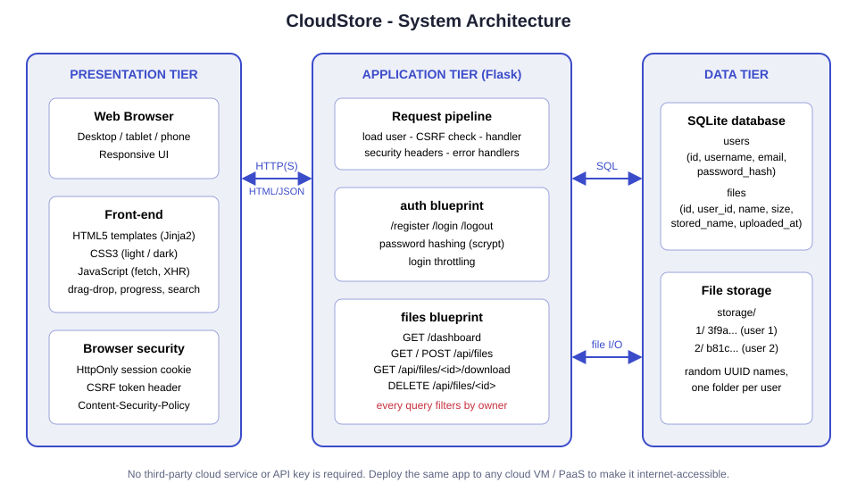
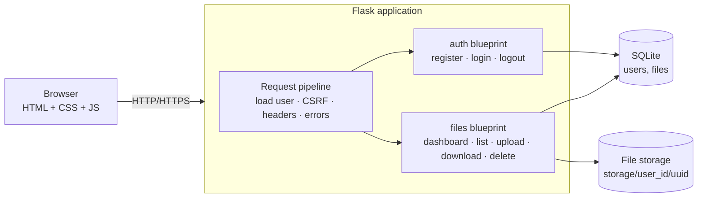
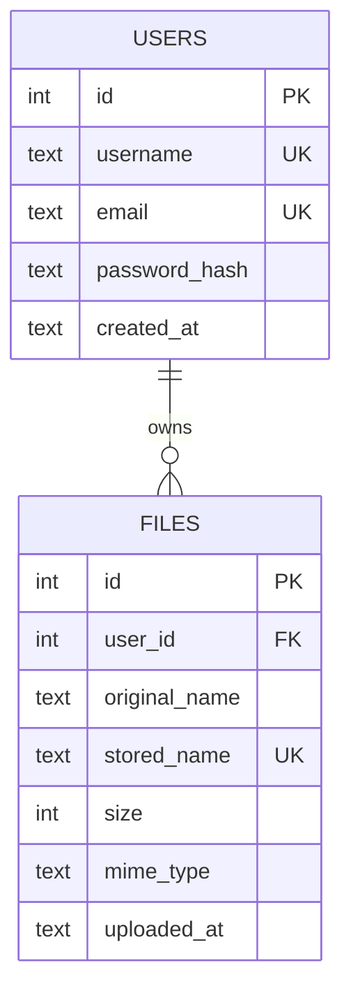
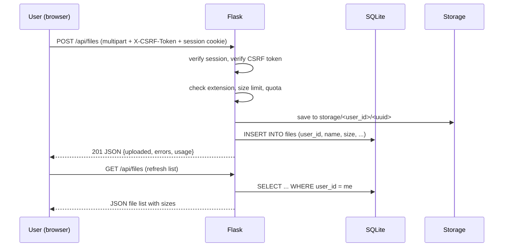
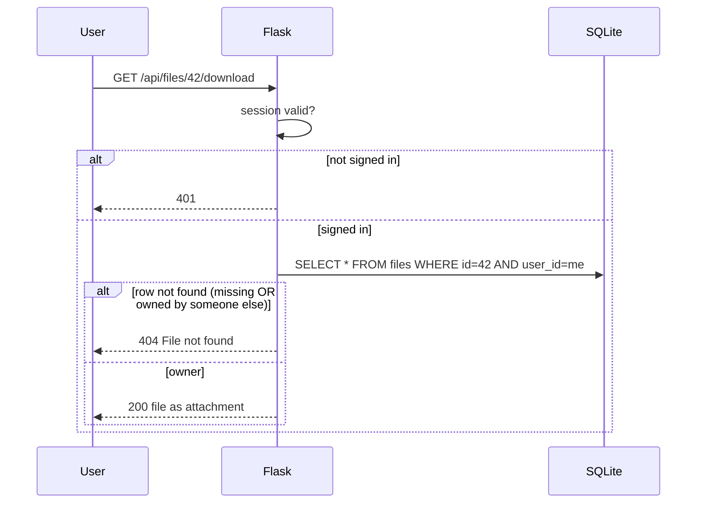
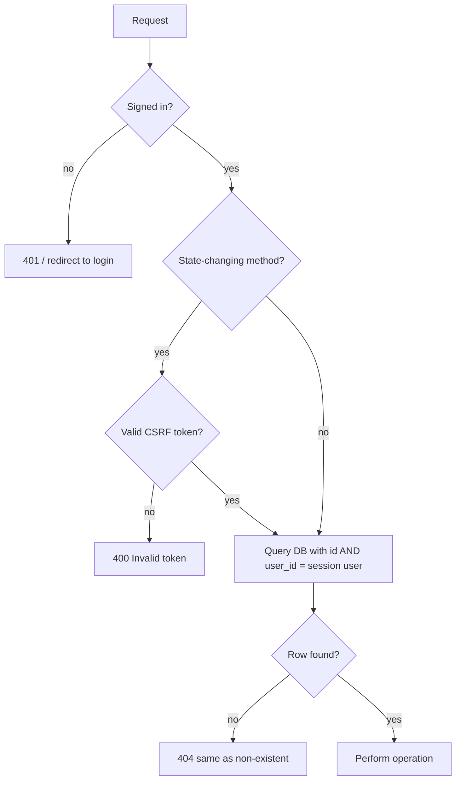

# System Architecture - CloudStore

## 1. Overview

CloudStore is a classic **three-tier web application**:

| Tier | Technology | Responsibility |
|------|------------|----------------|
| Presentation | HTML5 (Jinja2 templates), CSS3, vanilla JavaScript | Responsive UI, drag-and-drop upload with progress, search/sort, delete confirmation |
| Application | Python 3 + Flask (blueprints `auth` and `files`) | Authentication, sessions, validation, access control, REST-style JSON API |
| Data | SQLite database + per-user folders on disk | File metadata and users (SQLite); file bytes (`storage/<user_id>/<uuid>`) |

No external cloud provider, SDK or API key is required. The service is "cloud-based" in the sense that
the server owns the storage and users reach it from any device over HTTP(S); the same code can be
deployed to any cloud VM or PaaS (see README, *Deployment*).

## 2. Component diagram

## 3. Module map

| File | Purpose |
|------|---------|
| `run.py` | Starts the development server |
| `config.py` | Settings (limits, quotas, cookie flags) read from environment / `.env` |
| `app/__init__.py` | Application factory, error handlers |
| `app/db.py` | SQLite connection per request, schema creation |
| `app/auth.py` | Registration, login (with throttling), logout |
| `app/files.py` | Upload, list, download, delete, storage usage |
| `app/utils.py` | `login_required`, CSRF protection, security headers, size formatting, filename cleaning |
| `app/templates/` | Jinja2 pages (`base`, `index`, `register`, `login`, `dashboard`, `error`) |
| `app/static/` | `css/style.css`, `js/app.js`, `img/favicon.svg` |
| `tests/test_app.py` | 39 automated tests |
| `scripts/capture_screenshots.py` | Generates the screenshots in `docs/screenshots/` |

## 4. Database design (ER diagram)

* `files.user_id` is a foreign key with `ON DELETE CASCADE`.
* `stored_name` is a random UUID, so the original (user supplied) name never touches the file system.

## 5. Sequence diagrams

### 5.1 Upload

### 5.2 Download with access control

## 6. Access-control flow

## 7. Security design summary

| Threat | Countermeasure |
|--------|----------------|
| Reading/deleting other users' files | Every query includes `user_id`; foreign files return 404 |
| Password theft from database | Passwords hashed (Werkzeug scrypt, salted); never stored in plain text |
| Brute-force login | Lock-out after 5 failures for 5 minutes; same error for unknown user / wrong password |
| CSRF | Per-session token required on all POST/PUT/DELETE requests |
| XSS | Jinja2 auto-escaping, `textContent` in JavaScript, Content-Security-Policy (no inline scripts) |
| Path traversal | Files stored under random UUID names inside the owner's folder; display name sanitised |
| Session fixation / theft | Session cleared on login, HttpOnly + SameSite=Lax cookie, 2-hour lifetime |
| Disk exhaustion | Per-file limit, per-request limit, per-user quota |
| Malware executables | Blocked extensions (`exe`, `bat`, `cmd`, ...); downloads forced as attachments with `nosniff` |
| Clickjacking | `X-Frame-Options: DENY` + `frame-ancestors 'none'` |
| Information leak | Generic 500 page; stack traces only in server log |
