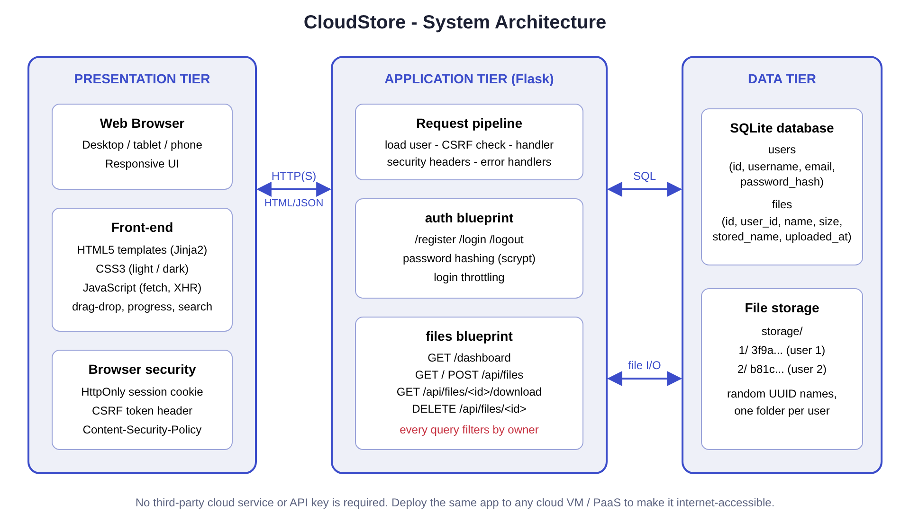
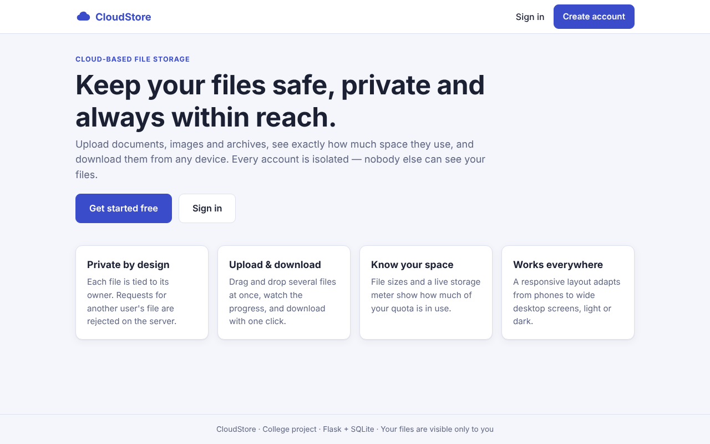
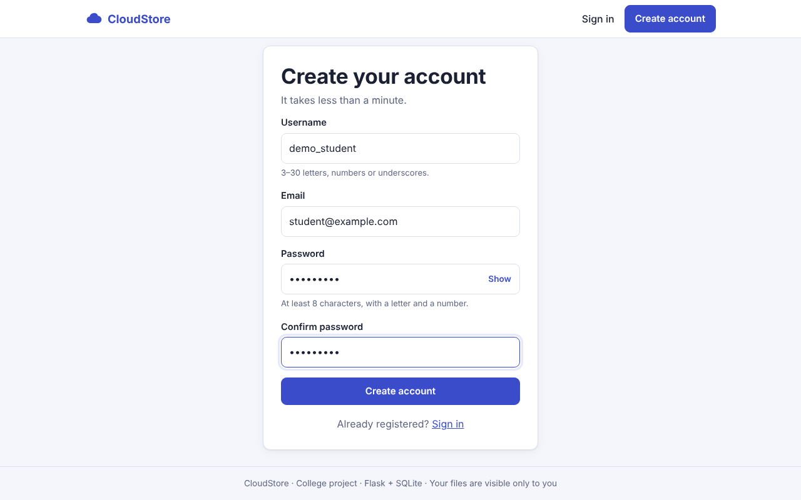
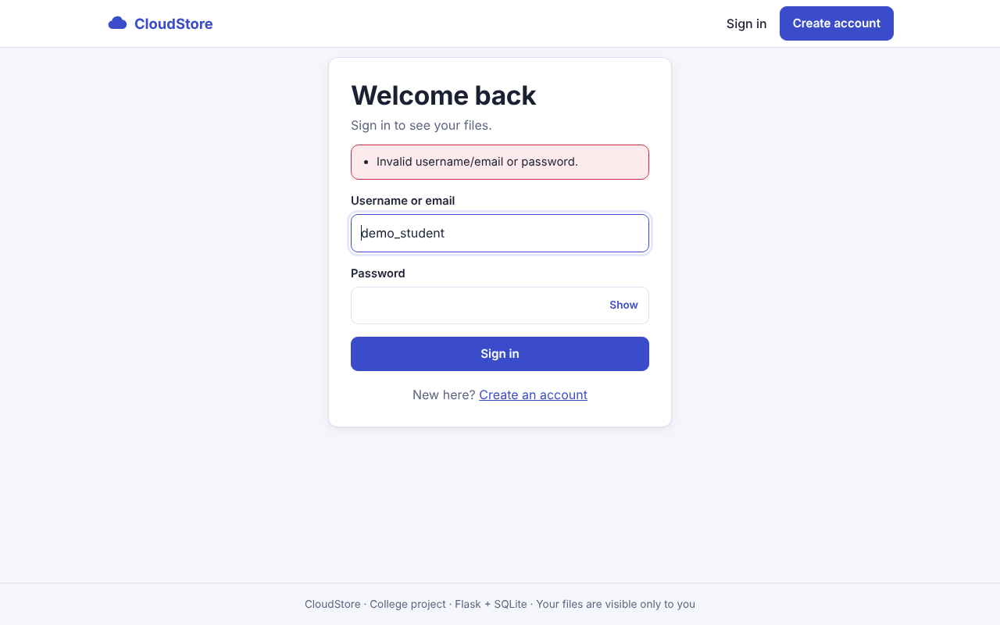
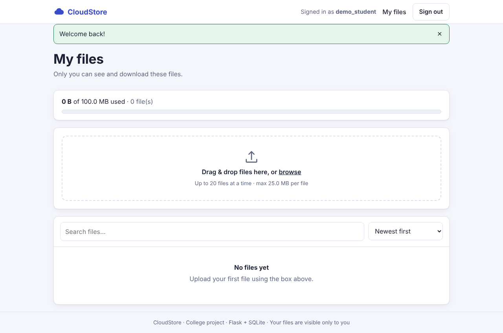
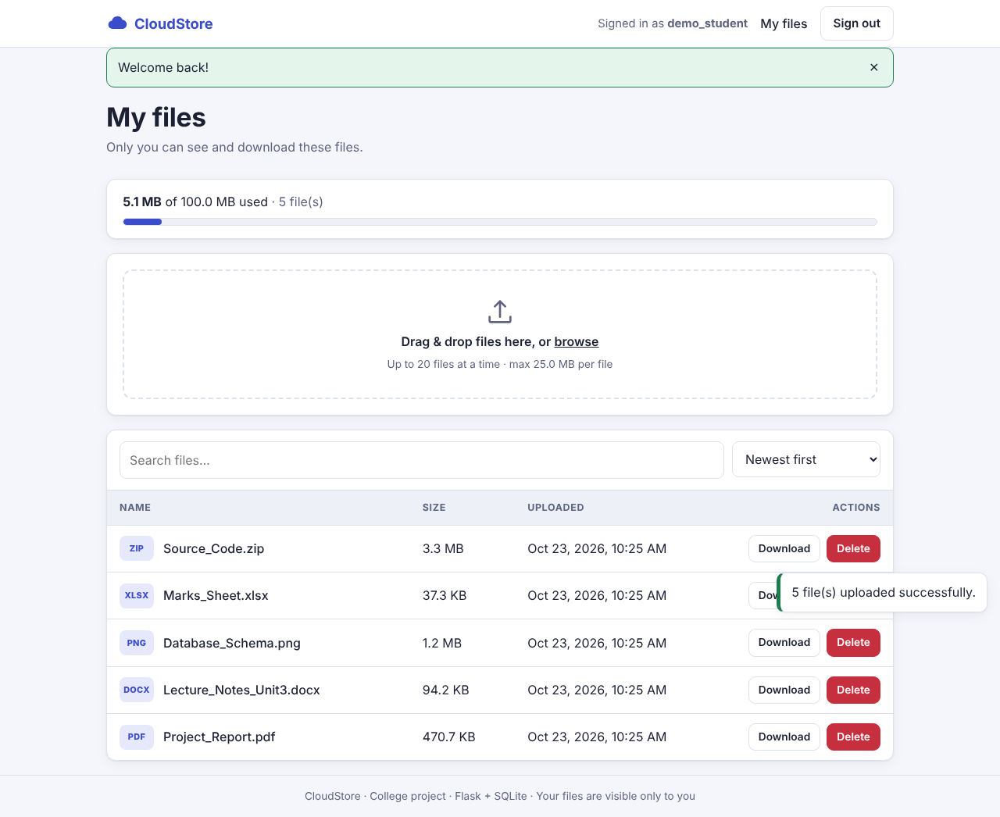
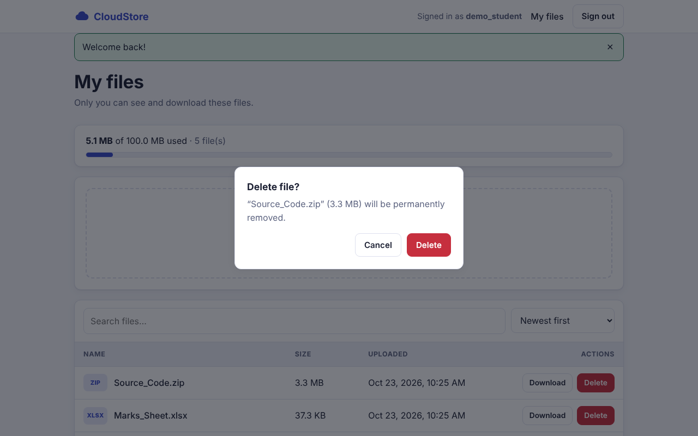
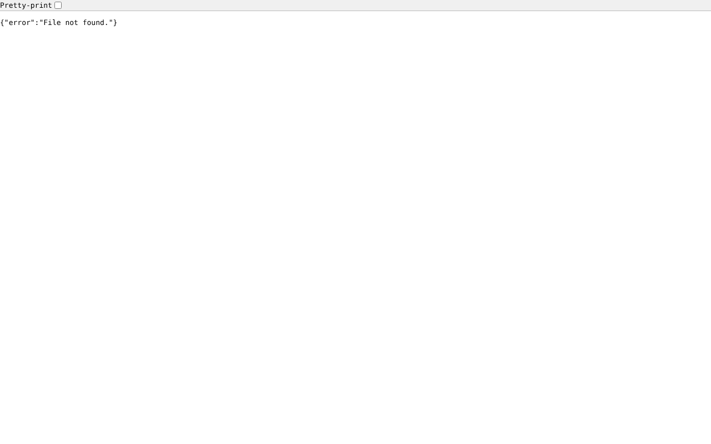
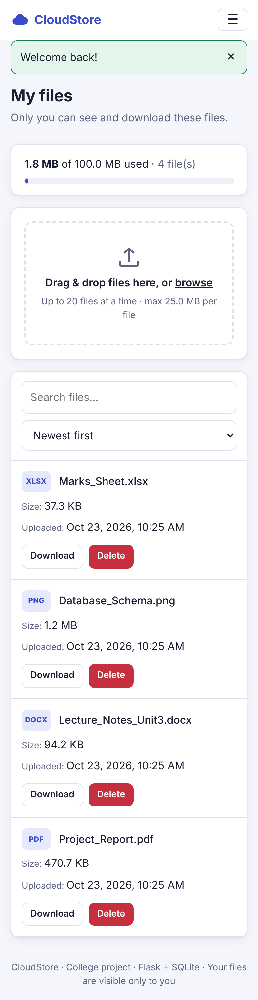

**Project title:** CloudStore - Cloud-Based File Storage System
**Technologies:** Python (Flask), HTML5, CSS3, JavaScript, SQLite
**Submitted by:** _(Student name / Roll number)_
**Guide:** _(Faculty name)_
**Department / College:** _(Department, College, University)_
**Academic year:** 2026-27

\newpage

# Certificate

This is to certify that the project entitled **"CloudStore - Cloud-Based File Storage System"** is a bonafide work carried out by _(student name)_, in partial fulfilment of the requirements for the award of the degree of _(degree)_ during the academic year 2026-27.

Guide: ____________________  Head of Department: ____________________  External Examiner: ____________________

# Acknowledgement

I express my sincere gratitude to my project guide, the Head of the Department and the faculty members for their guidance and encouragement throughout this project. I also thank my friends and family for their support.

# Abstract

Storing important documents on a single personal computer is risky: disks fail, devices are lost and files cannot be reached from elsewhere. Commercial cloud-storage services solve this, but understanding how they work requires building one. This project presents **CloudStore**, a web-based file storage system in which users create an account, sign in and upload, list, download and delete their files from any browser.

The backend is written in **Python with the Flask framework**; the frontend uses **HTML, CSS and JavaScript** without external libraries; user data and file metadata are stored in **SQLite**, while the file contents are stored on the server in a separate folder for every user under randomly generated names. Passwords are stored as salted hashes, sessions are protected with HttpOnly cookies and CSRF tokens, and every database query is restricted to the signed-in user so that **users can access only their own files**. The system also shows the size of each file, enforces per-file and per-user limits, handles errors gracefully and adapts to phones, tablets and desktops.

The application was verified with 39 automated tests (all passing) and with an end-to-end browser run that produced the screenshots included in this report.

**Keywords:** cloud storage, Flask, authentication, access control, file upload, web security, responsive design.

# Table of Contents

1. Introduction
2. Problem Statement
3. Objectives
4. Scope and Limitations
5. Literature / Technology Survey
6. System Requirements
7. System Analysis and Design
8. Implementation
9. Security Design
10. Testing
11. Results and Screenshots
12. Conclusion
13. Future Enhancements
14. References
15. Appendix - Installation and Source Layout

\newpage

# 1. Introduction

Cloud storage lets people keep files on a remote server and reach them through the internet. Services such as Google Drive, Dropbox and OneDrive are used by millions, yet their internal workings - user accounts, secure uploads, per-user isolation, quota accounting - are rarely seen by students. CloudStore is a compact but complete implementation of these ideas that can run on a laptop or on any cloud server.

The project follows the three-tier architecture (presentation, application, data) and uses only open-source tools, so it can be installed with two commands and no paid account or API key.

# 2. Problem Statement

Users need a simple, secure place to store files so that:

* files remain available from any device with a browser;
* each person's files are private - no other user can see, download or delete them;
* users can see what they have stored and how much space each file uses;
* the system stays reliable when users make mistakes (wrong password, oversized file, network failure).

Existing services are closed systems. There is a need for an open, understandable implementation that demonstrates the full life cycle of authenticated file storage.

# 3. Objectives

1. Provide user registration and login with secure password handling.
2. Allow authenticated users to upload one or many files with progress feedback.
3. List the user's files with name, size and upload date.
4. Allow download and deletion of files.
5. Guarantee that a user can access **only** their own files (access control).
6. Display file sizes and total storage usage against a quota.
7. Handle errors gracefully with clear messages.
8. Offer a responsive interface usable on mobile and desktop.
9. Document, test and package the project so it runs without any special configuration.

# 4. Scope and Limitations

**In scope:** registration, login/logout, upload, listing, size display, download, delete, search/sort, quota, security hardening, automated tests, documentation.

**Out of scope (future work):** file sharing between users, folders, password-reset by e-mail, versioning, virus scanning, distributed object storage.

**Limitations:** SQLite and local disk are suited to small and medium deployments; login throttling is held in memory of the running process; the application serves files itself rather than through a CDN.

# 5. Literature / Technology Survey

| Area | Options considered | Choice and reason |
|------|-------------------|-------------------|
| Backend language | Python, Java, Node.js, PHP | **Python** - readable, strong libraries, common in colleges |
| Web framework | Django, Flask, FastAPI | **Flask** - lightweight, ideal for learning request handling, blueprints and sessions |
| Database | MySQL, PostgreSQL, SQLite, Firebase | **SQLite** - zero configuration, ACID transactions, included in Python; no external service or credentials needed |
| File storage | Database BLOBs, local disk, S3/Firebase Storage | **Local disk** in per-user folders - simple, fast and easy to back up; can be swapped for object storage later |
| Frontend | React, Angular, plain JS | **Plain HTML/CSS/JS** - no build tools, works offline, easy to understand |
| Password hashing | MD5/SHA-1, bcrypt, scrypt, PBKDF2 | **scrypt via Werkzeug** - memory-hard, salted, recommended |

Related concepts studied: client-server model, REST principles, HTTP sessions and cookies, OWASP Top 10 (broken access control, injection, XSS, CSRF), multipart form uploads, responsive design with CSS media queries.

# 6. System Requirements

## 6.1 Functional requirements

| ID | Requirement |
|----|-------------|
| FR1 | A visitor can register with username, email and password |
| FR2 | A registered user can sign in with username or email and sign out |
| FR3 | A signed-in user can upload one or more files |
| FR4 | The system lists only the signed-in user's files |
| FR5 | The system shows the size of each file and total usage |
| FR6 | A user can download a file they own |
| FR7 | A user can delete a file they own after confirmation |
| FR8 | A user cannot read, list or delete another user's files |
| FR9 | The system rejects invalid input and shows clear error messages |

## 6.2 Non-functional requirements

| ID | Requirement |
|----|-------------|
| NFR1 | **Security** - hashed passwords, CSRF protection, secure headers, input validation |
| NFR2 | **Usability** - responsive layout, drag and drop, progress indication, notifications |
| NFR3 | **Reliability** - no orphaned files or records; errors never crash the server |
| NFR4 | **Portability** - runs on Windows, macOS and Linux with Python 3.10+ |
| NFR5 | **Maintainability** - modular code (blueprints), automated tests, documentation |
| NFR6 | **Performance** - list and download operations respond within milliseconds for typical sizes |

## 6.3 Hardware and software

* **Hardware:** any computer with 2 GB RAM and 1 GB free disk (plus storage for uploads).
* **Software:** Python 3.10+, pip, a modern browser (Chrome, Edge, Firefox, Safari).
* **Python packages:** Flask, python-dotenv (see `requirements.txt`).

# 7. System Analysis and Design

## 7.1 Architecture

CloudStore is a three-tier system (see figure below). The browser communicates with the Flask application over HTTP(S); the application reads and writes the SQLite database and the per-user folders.



* **Presentation tier:** Jinja2-rendered HTML pages, one CSS file, one JavaScript file. JavaScript performs uploads with `XMLHttpRequest` (for progress events), and list/delete calls with `fetch`.
* **Application tier:** Flask application factory with two blueprints - `auth` (register, login, logout) and `files` (dashboard, list, upload, download, delete) - plus a request pipeline that loads the current user, checks CSRF tokens, adds security headers and converts errors to friendly pages or JSON.
* **Data tier:** SQLite stores `users` and `files`; file contents are written to `storage/<user_id>/<uuid>`.

## 7.2 Data flow (summary)

**Level 0:** User -> (credentials, files, requests) -> CloudStore -> (pages, file lists, downloads) -> User.

**Level 1 processes:** (1) Authenticate user, (2) Manage files (upload / delete), (3) Retrieve files (list / download). Data stores: D1 `users`, D2 `files` metadata, D3 file storage.

## 7.3 Database design

**Table `users`**

| Column | Type | Notes |
|--------|------|-------|
| id | INTEGER | Primary key, auto-increment |
| username | TEXT | Unique, case-insensitive |
| email | TEXT | Unique, case-insensitive |
| password_hash | TEXT | Salted scrypt hash |
| created_at | TEXT | UTC timestamp |

**Table `files`**

| Column | Type | Notes |
|--------|------|-------|
| id | INTEGER | Primary key |
| user_id | INTEGER | Foreign key -> users(id), `ON DELETE CASCADE`, indexed |
| original_name | TEXT | Sanitised display name |
| stored_name | TEXT | Random UUID, unique - the real file name on disk |
| size | INTEGER | Bytes (shown as B/KB/MB/GB) |
| mime_type | TEXT | Guessed from the name; used for the download header |
| uploaded_at | TEXT | UTC timestamp |

Relationship: one user owns many files (1 : N).

## 7.4 Use cases

| Actor | Use case |
|-------|----------|
| Visitor | Register, Sign in |
| Signed-in user | Upload file(s), View file list and sizes, Search/sort, Download, Delete, Sign out |
| System | Validate input, enforce quota, enforce ownership |

## 7.5 Key sequences

**Upload:** the browser sends `POST /api/files` with the CSRF header and session cookie -> server verifies session and token -> validates extension, size and quota -> writes the file under a UUID name in the user's folder -> inserts a metadata row -> returns JSON -> browser refreshes the list.

**Download:** browser requests `/api/files/<id>/download` -> server runs `SELECT ... WHERE id = ? AND user_id = <me>` -> if no row, replies 404 -> otherwise streams the file as an attachment.

## 7.6 API design

| Method | Endpoint | Purpose |
|--------|----------|---------|
| GET | `/api/files` | List files and usage |
| POST | `/api/files` | Upload |
| GET | `/api/files/<id>/download` | Download |
| DELETE | `/api/files/<id>` | Delete |
| GET/POST | `/register`, `/login` | Account forms |
| POST | `/logout` | End session |
| GET | `/dashboard` | Main page |

# 8. Implementation

## 8.1 Project structure

```
cloud-file-storage/
  run.py  config.py  requirements.txt  .env.example  README.md
  app/  __init__.py  db.py  auth.py  files.py  utils.py
        templates/  static/{css,js,img}
  tests/test_app.py   scripts/capture_screenshots.py   docs/
```

## 8.2 Backend modules

* **`config.py`** reads limits and cookie flags from environment variables. If no secret key is configured, a random one is generated once and stored in `instance/secret_key`, so the project runs immediately yet no key is ever hard-coded.
* **`app/db.py`** opens one SQLite connection per request (`sqlite3.Row`), enables foreign keys and creates tables on start-up.
* **`app/auth.py`** validates registration (username pattern, e-mail pattern, password strength, confirmation), hashes passwords with `generate_password_hash`, authenticates with `check_password_hash` (comparing against a dummy hash for unknown users to keep timing similar), clears the session on login and throttles repeated failures.
* **`app/files.py`** implements the four file operations. Upload checks extension, emptiness, per-file size (on the stream, before writing), quota and writes with a UUID name; on any failure it removes partial files and rolls back, so storage and database stay consistent.
* **`app/utils.py`** provides `login_required`, CSRF verification, security headers, human-readable size formatting and file-name cleaning.
* **`app/__init__.py`** builds the app and registers handlers: HTTP errors and unexpected exceptions become a styled page (browsers) or `{"error": ...}` JSON (API); stack traces are only logged.

## 8.3 Frontend

* **Templates:** `base.html` (navigation, flash messages, toast area), `index`, `register`, `login`, `dashboard`, `error`.
* **CSS:** CSS variables for light and dark themes, fluid typography, a card layout and a media query at 720 px that turns the file table into stacked cards and the menu into a toggle.
* **JavaScript:** drag-and-drop upload with a progress bar, client-side size checks, toast notifications, live search and sorting, `<dialog>`-based delete confirmation, password show/hide, all values inserted with `textContent` (never `innerHTML`) to avoid XSS.

## 8.4 Error handling

| Situation | Behaviour |
|-----------|-----------|
| Invalid registration data | Form re-displayed with a list of problems, entered values kept |
| Wrong credentials | Generic message (does not reveal whether the user exists) |
| Too many failed logins | Temporary lock with message |
| Not signed in | Redirect to login (pages) or 401 JSON (API) |
| Missing/invalid CSRF token | 400 with instruction to refresh |
| File too large / empty / blocked type / quota exceeded | Per-file message, other files in the same upload still succeed |
| Request larger than limit | 413 JSON message |
| Another user's / unknown file id | 404 "File not found" |
| File bytes missing on disk | 404 with explanation |
| Network failure in browser | Toast "Network error..." |
| Unexpected exception | Generic 500 page, details only in the log |

# 9. Security Design

| Threat (OWASP) | Countermeasure in CloudStore |
|----------------|------------------------------|
| Broken access control | Ownership filter on every query; foreign ids return 404 |
| Cryptographic failures | Salted scrypt password hashes; random secret key; HttpOnly, SameSite cookies |
| Injection | Parameterised SQL everywhere; Jinja2 auto-escaping |
| XSS | `textContent` rendering, CSP `script-src 'self'` with no inline scripts |
| CSRF | Token in session, required for all state-changing requests |
| Security misconfiguration | `X-Frame-Options`, `X-Content-Type-Options`, `Referrer-Policy`, `Cache-Control: no-store`, debug off by default |
| Identification failures | Password rules, login throttling, session reset on login, 2-hour expiry |
| Unrestricted upload | Size/quota limits, blocked executable extensions, forced download with `nosniff`, UUID storage names |
| Path traversal | User-supplied names never used as paths |

# 10. Testing

## 10.1 Strategy

Automated unit/integration tests (Python `unittest` with Flask's test client, using a temporary database and storage folder for every test) plus an end-to-end browser run (Playwright/Chromium) that drives the real interface and captures screenshots.

## 10.2 Test cases

| ID | Test | Expected result | Result |
|----|------|-----------------|--------|
| T01 | Open home, login, register pages | HTTP 200 | Pass |
| T02 | Register with valid data | Redirect to login; user folder created | Pass |
| T03 | Register with bad username / short password | 400 with messages | Pass |
| T04 | Password without digit | Rejected | Pass |
| T05 | Password confirmation mismatch | Rejected | Pass |
| T06 | Duplicate username (any case) / email | Rejected | Pass |
| T07 | Password stored as hash | Hash prefix scrypt/pbkdf2, plain text absent | Pass |
| T08 | Login by username and by email | Redirect to dashboard | Pass |
| T09 | Wrong password / unknown user | Same generic error, 401 | Pass |
| T10 | Repeated failures | Account locked even for correct password | Pass |
| T11 | Logout | Dashboard no longer accessible | Pass |
| T12 | Logout via GET | 405 | Pass |
| T13 | POST without CSRF token | 400 | Pass |
| T14 | Dashboard / API without login | Redirect / 401 | Pass |
| T15 | Upload -> list -> download round trip | Same bytes, size shown, attachment header | Pass |
| T16 | Upload multiple files in one request | All stored | Pass |
| T17 | File size formatting (B, KB, MB, GB) | Correct strings | Pass |
| T18 | User B lists User A's files | Empty list | Pass |
| T19 | User B downloads User A's file | 404, no data | Pass |
| T20 | User B deletes User A's file | 404, file intact | Pass |
| T21 | Owner deletes file | Record and bytes removed, usage updated | Pass |
| T22 | Delete / upload without CSRF token | 400 | Pass |
| T23 | Upload with no file | 400 "No file selected" | Pass |
| T24 | Blocked extension (.exe) | Rejected | Pass |
| T25 | Empty file | Rejected | Pass |
| T26 | File over per-file limit | Rejected | Pass |
| T27 | Quota exceeded; other user unaffected | Rejected; separate quota | Pass |
| T28 | Request over size limit | 413 JSON | Pass |
| T29 | Filename `../../etc/passwd` | Stored as `passwd`, nothing escapes folder | Pass |
| T30 | Filename containing `<script>` | Output escaped | Pass |
| T31 | Stored bytes missing on disk | 404 | Pass |
| T32 | Unknown URL (page and API) | Styled 404 / JSON 404 | Pass |
| T33 | Security headers present | CSP, frame, nosniff, no-store | Pass |
| T34 | Unhandled exception | 500 page, no internals leaked | Pass |

(The suite contains 39 test methods in total; several rows above group related checks.)

## 10.3 Result

All 39 automated tests pass (`python -m unittest discover -s tests -v`). The browser run completed registration, login (including a failed login), upload of five files, delete with confirmation, a cross-user access attempt (404) and a mobile-width view without errors.

# 11. Results and Screenshots

The following figures were captured from the running system.


















# 12. Conclusion

CloudStore demonstrates how a cloud-style storage service can be built with a small, well-understood stack. All required features - registration, login, upload, download, delete, listing, file-size display and strict per-user access control - are implemented, with validation, error handling and a responsive interface. Security was treated as a design requirement rather than an afterthought, and the behaviour is verified by automated tests. The project can be installed in minutes without any external account, and the modular design allows each part (database, storage, authentication) to be upgraded independently.

# 13. Future Enhancements

1. Share files or folders with other users using expiring links and permissions.
2. Folders, rename, move and bulk operations.
3. Move metadata to PostgreSQL and file bytes to object storage (Amazon S3 or compatible) for scalability.
4. E-mail verification, password reset and two-factor authentication.
5. Server-side encryption at rest and antivirus scanning of uploads.
6. Chunked / resumable uploads for very large files.
7. File preview (images, PDF), version history and trash/restore.
8. Administrator dashboard and audit logs; shared rate-limit store (Redis).

# 14. References

1. Flask documentation - <https://flask.palletsprojects.com/>
2. Werkzeug security utilities - <https://werkzeug.palletsprojects.com/>
3. SQLite documentation - <https://www.sqlite.org/docs.html>
4. OWASP Top 10 - <https://owasp.org/www-project-top-ten/>
5. OWASP Cheat Sheet Series (CSRF, File Upload, Password Storage) - <https://cheatsheetseries.owasp.org/>
6. MDN Web Docs (HTML, CSS, JavaScript, Fetch, Content-Security-Policy) - <https://developer.mozilla.org/>
7. Python `unittest` documentation - <https://docs.python.org/3/library/unittest.html>

# 15. Appendix - Installation and Source Layout

```bash
cd cloud-file-storage
python -m venv venv
venv\Scripts\activate        # macOS/Linux: source venv/bin/activate
pip install -r requirements.txt
python run.py                # open http://127.0.0.1:5000
python -m unittest discover -s tests -v
```

Source files: `run.py`, `config.py`, `app/__init__.py`, `app/db.py`, `app/auth.py`, `app/files.py`, `app/utils.py`, `app/templates/*.html`, `app/static/css/style.css`, `app/static/js/app.js`, `tests/test_app.py`. The complete source code is included in the project ZIP.
